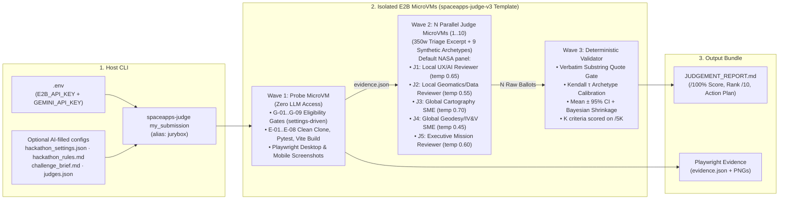

<div align="center">

# ⚖️ JuryBox
### **Calibrated Multi-MicroVM Pre-Submission Jury & Eligibility Gatekeeper for Any Hackathon — Born at the NASA Space Apps Challenge**

[](LICENSE)
[](e2b_template/e2b.Dockerfile)
[-2ea043?style=for-the-badge)](src/spaceapps_judge/vm/calibration_cohort.py)
[](src/spaceapps_judge/vm/report.py)

*Audit your hard eligibility gates (`G-01..G-09`), empirical repo build/tests (`E-01..E-08`), calibrated cohort rank (`/10`), and N-judge debriefs (`1..10` judges, `K` criteria) inside isolated E2B MicroVMs before locking in your hackathon submission.*

*JuryBox is the universal evolution of **SpaceApps E2B Judge v3.0**, which I designed and built for the NASA Space Apps Challenge 2026 — see [Lineage](#%EF%B8%8F-lineage--spaceapps-e2b-judge-v30) at the end.*

</div>

---

## 🎯 Why I Built JuryBox

During hackathons like the **NASA Space Apps Challenge**, **ETHGlobal** or **Devpost** events, reviewers evaluate dozens of submissions in a compressed window—typically spending **3 to 5 minutes (`180s–300s`)** per team. Naive single-LLM self-evaluations suffer from severe **sycophancy and score inflation**: a single LLM reading a long marketing README will happily award a perfect score even when a project is missing its mandatory demo or live public URL.

I built **JuryBox** (originally *SpaceApps E2B Judge v3.0*) to solve both problems with empirical sandbox isolation and cohort calibration:

1. **Zero-LLM Empirical Gatekeeper (Wave 1 MicroVM):** An isolated E2B Sandbox with **no LLM key** clones your public GitHub repository anonymously, runs `pytest` and `npm run build`, opens your live `public_url` in headless **Playwright Chromium** (capturing desktop, interaction, and mobile screenshots), checks external URL reachability (`HTTP 200/301/302`, flagging `403/429` bot-blocks as reachable-with-caveat and failing `404/5xx`/DNS errors), and checks your demo deliverable against your hackathon's limits (NASA default: `<= 7` slides for PDF/PPTX or `<= 30 s` video; fully configurable in `hackathon_settings.json`).
2. **Calibrated 10-Project Blind Cohort & Multi-Model Jury (Wave 2 — N Parallel MicroVMs):** By default, five generic institutional judge roles (`J1_local_ux_ai_reviewer`, `J2_local_geomatics_data_reviewer`, `J3_global_planetary_cartography_sme`, `J4_global_geodesy_ivv_sme`, `J5_exec_mission_directorate_reviewer`) run in separate MicroVMs across distinct temperatures (`0.45`–`0.70`) with a 2-slot staggered rate limiter. With a `judges.json`, any panel of **1 to 10 judges** runs instead (up to 8 VMs in parallel). Instead of scoring in a vacuum, each judge ranks your submission blindly inside a shuffled **10-project cohort** containing **9 synthetic reference archetypes** (`SYNTH_ARCH_01..09`) spanning 4 defined quality tiers.
3. **Anti-Marketing Triage Excerpt:** Local (`TIER_1_LOCAL`) and Executive (`TIER_3_EXEC`) judges receive a **350-word triage excerpt** of your submission text plus the empirical Wave 1 probe ledger and a prompt-enforced `180s–300s` simulated triage budget—mirroring a rapid judging pass focused on verified deliverables rather than a 3,000-word README. Any unknown tier is normalized to `TIER_2_SME` (full text), so a judge is never truncated by mistake.
4. **Deterministic Anti-Hallucination Verifier & Judge Debrief (Wave 3):** Pure Python code (`report.py`) verifies that every score cites a **verbatim normalized substring** from your submission or the Wave 1 evidence ledger, checks each judge's Kendall $\tau$ concordance against the 9 synthetic calibration archetypes (bands rescaled to `/5K`), applies Bayesian shrinkage (`mean ± 95% CI`), and requires a **5-part debrief** from each judge:
   - *What I judged & how*
   - *Why you received this exact score*
   - *What concrete fix before the deadline will flip my vote*
   - *Positive highlights that stood out*
   - *🔒 Must Keep Sacred (what you must never break during final edits)*

---

## 🏗️ 3-Wave Isolated Architecture



---

## ⚡ Quickstart

### 1. Clone & Install

```bash
git clone https://github.com/SeCuReDmE-main-dev/spaceapps-e2b-judge.git
cd spaceapps-e2b-judge
pip install -e ".[dev]"
```

### 2. Configure Your API Keys

Copy `.env.example` to `.env` and add your [E2B API key](https://e2b.dev) and [Gemini API key](https://aistudio.google.com/):

```bash
cp .env.example .env
```

### 3. Define Your Submission (`submission.json`)

Edit `examples/sample_submission/submission.json` (or create your own folder):

```json
{
  "project_title": "Your Project Name",
  "challenge": "Interplanetary Survival Guide: Martian Map",
  "repo_url": "https://github.com/your-org/your-repo",
  "repo_branch": "main",
  "public_url": "https://your-live-demo.vercel.app",
  "demo_file": "slides_7p.pdf",
  "submission_text_file": "submission_text.md",
  "deadline_local_iso": "2026-11-15T23:59:00-05:00"
}
```

### 4. Run the Judge Panel

```bash
# Full Wave 1 + Wave 2 + Wave 3 run (~2-4 minutes on base sandbox; ~60-90s with pre-baked E2B template)
spaceapps-judge examples/sample_submission

# Use your own challenge brief (for challenges other than Martian Map)
spaceapps-judge examples/sample_submission --challenge-rubric path/to/your_challenge_brief.md

# Rapid iteration (~45-60s): reuse Wave 1 probes/screenshots from a previous run
spaceapps-judge examples/sample_submission --reuse-wave1 reports/judge/<previous_run_dir>
```

Without any extra configuration file, JuryBox behaves exactly like SpaceApps E2B Judge v3.0 (NASA Space Apps 2026 rules, 5 judges, 5 criteria on `/25`).

---

## 🔄 Use for Any Hackathon & Judge Panel (AI-Ready Templates)

The [`templates/`](templates/) folder contains three self-documented gabarits with `<!-- AI AGENT INSTRUCTIONS -->` blocks, written so that any coding agent (Antigravity, Claude Code, Codex, Gemini CLI...) can fill them from your hackathon's official pages:

| Template | Produces (in your submission folder) | Drives |
|---|---|---|
| [`hackathon_settings_template.json`](templates/hackathon_settings_template.json) | `hackathon_settings.json` | Gates `G-04..G-08`, the `K` criteria (`/5K`), the official awards |
| [`hackathon_rules_template.md`](templates/hackathon_rules_template.md) | `hackathon_rules.md` + `challenge_brief.md` | The judging guide and challenge brief injected into every judge prompt |
| [`judge_panel_template.json`](templates/judge_panel_template.json) | `judges.json` | `1..10` judge personas (tier, model, temperature, time budget, public profile) |

### Prompt 1 — Hackathon Rules & Gate Settings (copy-paste to your AI)

```text
You are preparing my hackathon submission folder `my_submission/` for the JuryBox pre-submission judge
(https://github.com/SeCuReDmE-main-dev/spaceapps-e2b-judge).

1. Read the official pages of my hackathon: <RULES URL>, <JUDGING CRITERIA URL>, <PRIZES URL>,
   and the page of my challenge / track: <CHALLENGE URL>.
2. Follow templates/hackathon_settings_template.json and create my_submission/hackathon_settings.json:
   hackathon_name; gates (max_slides, max_video_sec, require_demo_file, required_language,
   required_keywords, require_references, require_ai_disclosure); criteria (the official K judging
   criteria with their descriptions); awards (official prize names, or [] if there is no official list).
   Set every field explicitly. Use null (no limit) or [] (nothing mandatory) when the rules impose nothing.
   Never invent a rule.
3. Follow templates/hackathon_rules_template.md and create my_submission/hackathon_rules.md (PART A:
   eligibility, judging criteria with their top-score wording, phases, prizes) and
   my_submission/challenge_brief.md (PART B: the brief of my challenge / track), copying official
   wording and source URLs.
4. Check that criteria names and award names are identical across the three files, that the JSON is strict,
   and list every value you could not find in the official rules.
```

### Prompt 2 — Judge Personalities (4, 5, 6 or N Judges) (copy-paste to your AI)

```text
Build the judging panel of my hackathon in my_submission/judges.json by following
templates/judge_panel_template.json.

1. The panel has <N> judges (any number from 1 to 10): <judge names / official judges page URL,
   or "build a realistic panel for this hackathon">.
2. For each judge, use ONLY public professional sources (official judge page, LinkedIn summary, GitHub,
   talks, papers, blog posts) and fill: tier (TIER_1_LOCAL, TIER_2_SME or TIER_3_EXEC), preferred_model,
   temperature (0.45-0.70, vary it across judges), time_limit_sec (180-300), queue_pressure, and
   role {title, bio, expertise, signature_criteria, red_flags, judging_style}.
3. Use short role-based ids such as J1_local_web3_reviewer. Never include private data (contact details,
   family, health, address) and never caricature a real person: describe the judging lens only.
4. Return strict JSON, then summarize which public sources you used for each judge.
```

### Run

```bash
spaceapps-judge my_submission      # or the new alias: jurybox my_submission
```

```text
my_submission/
├── submission.json
├── submission_text.md
├── slides.pdf | demo.mp4
├── hackathon_settings.json   ← Prompt 1 (auto-detected)
├── hackathon_rules.md        ← Prompt 1 (auto-detected)
├── challenge_brief.md        ← Prompt 1 (auto-detected)
└── judges.json               ← Prompt 2 (auto-detected)
```

Each file is auto-detected in the submission folder; an explicit flag always wins: `--hackathon-settings`, `--judging-guide`, `--challenge-rubric`, `--judges-config`. Invalid JSON or an out-of-range panel (`0` or `>10` judges) stops the run on the host **before** any VM is billed.

| Setting | Effect |
|---|---|
| `gates.max_slides` / `gates.max_video_sec` / `gates.require_demo_file` | `G-04` demo limits (`null` = no limit; demo optional → `INFO`, never blocking) |
| `gates.required_language` | `G-05` language detection (`null` = any language accepted) |
| `gates.required_keywords` | `G-06` sponsor / dataset keywords (`[]` → `PASS`, never blocks eligibility) |
| `gates.require_references` / `gates.require_ai_disclosure` | `G-07` / `G-08` (`false` → `INFO`) |
| `criteria` (`K` items) | JSON schema, prompts and report scored on `/5K` (4 criteria = `/20`) |
| `awards` | `award_fit` must match the list; `[]` = free-form awards, none rejected by name |
| `judges.json` tiers | Aliases normalized: `LOCAL` → `TIER_1_LOCAL`, `SME`/`TECHNICAL` → `TIER_2_SME`, `EXEC`/`VIP` → `TIER_3_EXEC`; unknown → `TIER_2_SME` |

> **Limit I want to be explicit about:** the 9 calibration archetypes (`SYNTH_ARCH_01..09`) are synthetic NASA/Mars-themed projects. For other hackathons they still anchor *quality tiers* (complete vs. incomplete deliverables), but they are not domain-matched. Simulated judges built from public profiles are a rehearsal tool, not a prediction of the real jury.

---

## 🐳 Optional: Pre-Baked E2B Sandbox Template (`< 2s` VM Boot)

By default, `spaceapps-judge` works on any standard E2B account and automatically installs `playwright`, `pypdf`, `python-pptx`, `langdetect`, and `@google/gemini-cli` inside the sandbox if needed (logging a clear notice if a custom template is not found).

To eliminate package setup time inside the VMs, build the included E2B template in [`e2b_template/`](e2b_template/BUILD_TEMPLATE.md):

```bash
cd e2b_template
e2b template build --name spaceapps-judge-v3
spaceapps-judge ../examples/sample_submission --template spaceapps-judge-v3
```

---

## 📊 Sample Calibrated Output (`examples/sample_report/JUDGEMENT_REPORT.md`)

See the full sample report in [`examples/sample_report/JUDGEMENT_REPORT.md`](examples/sample_report/JUDGEMENT_REPORT.md), generated with the default NASA Space Apps configuration on a pre-deployment draft of `marswalk` where the codebase passes `E-01..E-08` (`110 pytest` passing, clean Vite build, `11/11` reachable citations) **but mandatory delivery gates `G-01`/`G-02` (`public_url`) and `G-04` (`demo_file`) are intentionally still missing (`FAIL`)**:

- **Eligibility Verdict**: **`NON ADMISSIBLE` (`eligible = False`, `nomination_votes = 0/5`)** because `G-01`, `G-02`, and `G-04` are failing in the draft state.
- **Blind Cohort Rank (`/10`)**: **`#4 / 10`** — ranked behind complete Tier-4/Tier-3 reference archetypes (`SYNTH_ARCH_01`, `SYNTH_ARCH_02`, `SYNTH_ARCH_04`) solely because missing `public_url` and `demo_file` cap `Presentation` at `1.6/5 (32%)`. All 5 judges explicitly state in `what_would_change_my_verdict` that deploying the frontend (`G-01`/`G-02`) and attaching the 7-slide PDF or $\le 30\text{s}$ video (`G-04`) lifts `Presentation` to `5/5` and moves the entry to **`#1 / 10`**.

| Critère | Médiane (`/5`) | Médiane (`%`) | Moyenne (`/5`) | Moyenne (`%`) | `J1` (Local UX/AI) | `J2` (Local Geomatics) | `J3` (Global Carto SME) | `J4` (Global IV&V SME) | `J5` (Exec Mission) |
| :--- | :---: | :---: | :---: | :---: | :---: | :---: | :---: | :---: | :---: |
| **Impact** | **4 / 5** | **`80.0%`** | 4.0 / 5 | **`80.0%`** | 4/5 (80%) | 4/5 (80%) | 4/5 (80%) | 4/5 (80%) | 4/5 (80%) |
| **Creativity** | **5 / 5** | **`100.0%`** | 4.6 / 5 | **`92.0%`** | 4/5 (80%) | 4/5 (80%) | 5/5 (100%) | 5/5 (100%) | 5/5 (100%) |
| **Validity** | **5 / 5** | **`100.0%`** | 5.0 / 5 | **`100.0%`** | 5/5 (100%) | 5/5 (100%) | 5/5 (100%) | 5/5 (100%) | 5/5 (100%) |
| **Relevance** | **5 / 5** | **`100.0%`** | 4.8 / 5 | **`96.0%`** | 5/5 (100%) | 4/5 (80%) | 5/5 (100%) | 5/5 (100%) | 5/5 (100%) |
| **Presentation** | **2 / 5** | **`40.0%`** | 1.6 / 5 | **`32.0%`** | 2/5 (40%) | 1/5 (20%) | 1/5 (20%) | 2/5 (40%) | 2/5 (40%) |
| **TOTAL GLOBAL** | **21 / 25** | **`84.0%`** | **20.0 / 25** | **`80.0%`** | **80.0%** | **72.0%** | **80.0%** | **84.0%** | **84.0%** |

---

## 🧪 Verification & Hygiene Suite

Run the automated test suite and linter before committing:

```bash
pytest -q --tb=short
ruff check .
```

The suite covers the NASA v3.0 back-compatibility (byte-identical default judge prompt), 4- and 6-judge custom panels on `/20`, a non-NASA hackathon end to end (gates → eligibility → report), tier aliases, config validation, the anti-hallucination validator, and repository hygiene (no local paths, secrets, or real judge names).

---

## 🤝 Collaboration & Engineering Disclosure

> I used Google Antigravity to its fullest potential as a research and engineering partner—for code mapping, architectural iteration, consistency checks, and deliverable preparation—alongside independent automated verification and live screen replay. I formulated the intent, defined the scope, arbitrated the design decisions, and validated every line. This collaboration expands my engineering capacity; judgment, responsibility, authorship, and final signature remain under my authority. Evidence can travel; authority stays human.

**Coding & maintenance agent:** Claude Code (Anthropic · Claude Opus 5.5) — implementation, tests and maintenance of the universal hackathon / N-judge layer (`hackathon_config.py`, settings-driven gates, dynamic `K`-criteria scoring, AI-ready templates), under my direction.

## 📜 License

Released under the [Apache-2.0 License](LICENSE).

---

## 🕰️ Lineage — SpaceApps E2B Judge v3.0

JuryBox started as **SpaceApps E2B Judge v3.0**, a tool I designed and built (author & architect: Jean-Sébastien Beaulieu) to audit my own entry to the **NASA Space Apps Challenge 2026** (*Interplanetary Survival Guide: Martian Map*) before the November 15, 2026 deadline.

**What v3.0 was:** a NASA-only pre-submission judge with a fixed panel of **5 generic institutional role judges** (2 local, 2 global SME, 1 executive), the **5 official NASA criteria** scored on **`/25`**, the **10 NASA Global Awards**, and hard-coded NASA eligibility gates (`7`-slide deck or `30 s` video, English text, NASA data/mission terms, References section, AI disclosure). Its core ideas—a zero-LLM probe VM, one isolated MicroVM per judge, a blind 10-project calibration cohort, and a deterministic verbatim-quote verifier—carry over unchanged.

**What JuryBox adds:** any hackathon and any panel (`1..10` judges, `K` criteria on `/5K`, custom demo/language/keyword rules, custom or free-form awards) through AI-ready templates. With no configuration file, the NASA Space Apps v3.0 behavior remains the exact default, and the `spaceapps-judge` command, the package name and this repository URL stay the same.
