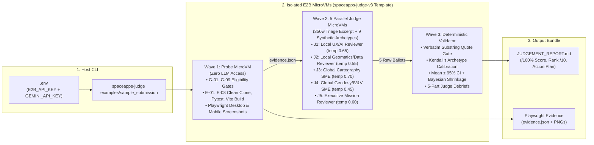

<div align="center">

# ⚖️ SpaceApps E2B Judge v3.0
### **Calibrated Multi-MicroVM Pre-Submission Auditor & Eligibility Gatekeeper for NASA Space Apps Challenge Teams**

[](LICENSE)
[](e2b_template/e2b.Dockerfile)
[-2ea043?style=for-the-badge)](src/spaceapps_judge/vm/calibration_cohort.py)
[](src/spaceapps_judge/vm/report.py)

*Audit your hard eligibility gates (`G-01..G-09`), empirical repo build/tests (`E-01..E-08`), calibrated cohort rank (`/10`), and 5-judge debriefs inside isolated E2B MicroVMs before locking in your Space Apps submission.*

</div>

---

## 🎯 Why I Built SpaceApps E2B Judge v3.0

During hackathons like the **NASA Space Apps Challenge**, local and global reviewers evaluate dozens of submissions in a compressed window—typically spending **3 to 5 minutes (`180s–300s`)** per team. Naive single-LLM self-evaluations suffer from severe **sycophancy and score inflation**: a single LLM reading a long marketing README will happily award `25/25 (100%)` even when a project is missing its mandatory 7-slide deck / 30-second video or live public URL.

I built **SpaceApps E2B Judge v3.0** to solve both problems with empirical sandbox isolation and cohort calibration:

1. **Zero-LLM Empirical Gatekeeper (Wave 1 MicroVM):** An isolated E2B Sandbox with **no LLM key** clones your public GitHub repository anonymously, runs `pytest` and `npm run build`, opens your live `public_url` in headless **Playwright Chromium** (capturing desktop, interaction, and mobile screenshots), checks external URL reachability (`HTTP 200/301/302`, flagging `403/429` bot-blocks as reachable-with-caveat and failing `404/5xx`/DNS errors), and checks your demo deliverable (`<= 7` slides for PDF/PPTX, or `<= 240s` hard ceiling for video files with a warning above `30s`).
2. **Calibrated 10-Project Blind Cohort & Multi-Model Jury (Wave 2 — 5 Parallel MicroVMs):** Five generic institutional judge roles (`J1_local_ux_ai_reviewer`, `J2_local_geomatics_data_reviewer`, `J3_global_planetary_cartography_sme`, `J4_global_geodesy_ivv_sme`, `J5_exec_mission_directorate_reviewer`) run in separate MicroVMs across distinct temperatures (`0.45`–`0.70`) with a 2-slot staggered rate limiter. Instead of scoring in a vacuum, each judge ranks your submission blindly inside a shuffled **10-project cohort** containing **9 synthetic reference archetypes** (`SYNTH_ARCH_01..09`) spanning 4 defined quality tiers.
3. **Anti-Marketing Triage Excerpt:** Local (`TIER_1_LOCAL`) and Executive (`TIER_3_EXEC`) judges receive a **350-word triage excerpt** of your submission text plus the empirical Wave 1 probe ledger and a prompt-enforced `180s–300s` simulated triage budget—mirroring a rapid judging pass focused on verified deliverables rather than a 3,000-word README.
4. **Deterministic Anti-Hallucination Verifier & Judge Debrief (Wave 3):** Pure Python code (`report.py`) verifies that every score cites a **verbatim normalized substring** from your submission or the Wave 1 evidence ledger, checks each judge's Kendall $\tau$ concordance against the 9 synthetic calibration archetypes, applies Bayesian shrinkage (`mean ± 95% CI`), and requires a **5-part debrief** from each judge:
   - *What I judged & how*
   - *Why you received this exact score*
   - *What concrete fix before the deadline will flip my vote*
   - *Positive highlights that stood out*
   - *🔒 Must Keep Sacred (what you must never break during final edits)*

---

## 🏗️ 3-Wave Isolated Architecture



---

## ⚡ Quickstart

### 1. Clone & Install

```bash
git clone https://github.com/SeCuReDmE-main-dev/spaceapps-e2b-judge.git
cd spaceapps-e2b-judge
pip install -e ".[dev]"
```

### 2. Configure Your API Keys

Copy `.env.example` to `.env` and add your [E2B API key](https://e2b.dev) and [Gemini API key](https://aistudio.google.com/):

```bash
cp .env.example .env
```

### 3. Define Your Submission (`submission.json`)

Edit `examples/sample_submission/submission.json` (or create your own folder):

```json
{
  "project_title": "Your Project Name",
  "challenge": "Interplanetary Survival Guide: Martian Map",
  "repo_url": "https://github.com/your-org/your-repo",
  "repo_branch": "main",
  "public_url": "https://your-live-demo.vercel.app",
  "demo_file": "slides_7p.pdf",
  "submission_text_file": "submission_text.md",
  "deadline_local_iso": "2026-11-15T23:59:00-05:00"
}
```

### 4. Run the 5-MicroVM Judge Panel

```bash
# Full Wave 1 + Wave 2 + Wave 3 run (~2-4 minutes on base sandbox; ~60-90s with pre-baked E2B template)
spaceapps-judge examples/sample_submission

# Use your own challenge brief (for challenges other than Martian Map)
spaceapps-judge examples/sample_submission --challenge-rubric path/to/your_challenge_brief.md

# Rapid iteration (~45-60s): reuse Wave 1 probes/screenshots from a previous run
spaceapps-judge examples/sample_submission --reuse-wave1 reports/judge/<previous_run_dir>
```

---

## 🐳 Optional: Pre-Baked E2B Sandbox Template (`< 2s` VM Boot)

By default, `spaceapps-judge` works on any standard E2B account and automatically installs `playwright`, `pypdf`, `python-pptx`, `langdetect`, and `@google/gemini-cli` inside the sandbox if needed (logging a clear notice if a custom template is not found).

To eliminate package setup time inside the VMs, build the included E2B template in [`e2b_template/`](e2b_template/BUILD_TEMPLATE.md):

```bash
cd e2b_template
e2b template build --name spaceapps-judge-v3
spaceapps-judge ../examples/sample_submission --template spaceapps-judge-v3
```

---

## 📊 Sample Calibrated Output (`examples/sample_report/JUDGEMENT_REPORT.md`)

See the full sample report in [`examples/sample_report/JUDGEMENT_REPORT.md`](examples/sample_report/JUDGEMENT_REPORT.md), generated on a pre-deployment draft of `marswalk` where the codebase passes `E-01..E-08` (`110 pytest` passing, clean Vite build, `11/11` reachable citations) **but mandatory delivery gates `G-01`/`G-02` (`public_url`) and `G-04` (`demo_file`) are intentionally still missing (`FAIL`)**:

- **Eligibility Verdict**: **`NON ADMISSIBLE` (`eligible = False`, `nomination_votes = 0/5`)** because `G-01`, `G-02`, and `G-04` are failing in the draft state.
- **Blind Cohort Rank (`/10`)**: **`#4 / 10`** — ranked behind complete Tier-4/Tier-3 reference archetypes (`SYNTH_ARCH_01`, `SYNTH_ARCH_02`, `SYNTH_ARCH_04`) solely because missing `public_url` and `demo_file` cap `Presentation` at `1.6/5 (32%)`. All 5 judges explicitly state in `what_would_change_my_verdict` that deploying the frontend (`G-01`/`G-02`) and attaching the 7-slide PDF or $\le 30\text{s}$ video (`G-04`) lifts `Presentation` to `5/5` and moves the entry to **`#1 / 10`**.

| Critère | Médiane (`/5`) | Médiane (`%`) | Moyenne (`/5`) | Moyenne (`%`) | `J1` (Local UX/AI) | `J2` (Local Geomatics) | `J3` (Global Carto SME) | `J4` (Global IV&V SME) | `J5` (Exec Mission) |
| :--- | :---: | :---: | :---: | :---: | :---: | :---: | :---: | :---: | :---: |
| **Impact** | **4 / 5** | **`80.0%`** | 4.0 / 5 | **`80.0%`** | 4/5 (80%) | 4/5 (80%) | 4/5 (80%) | 4/5 (80%) | 4/5 (80%) |
| **Creativity** | **5 / 5** | **`100.0%`** | 4.6 / 5 | **`92.0%`** | 4/5 (80%) | 4/5 (80%) | 5/5 (100%) | 5/5 (100%) | 5/5 (100%) |
| **Validity** | **5 / 5** | **`100.0%`** | 5.0 / 5 | **`100.0%`** | 5/5 (100%) | 5/5 (100%) | 5/5 (100%) | 5/5 (100%) | 5/5 (100%) |
| **Relevance** | **5 / 5** | **`100.0%`** | 4.8 / 5 | **`96.0%`** | 5/5 (100%) | 4/5 (80%) | 5/5 (100%) | 5/5 (100%) | 5/5 (100%) |
| **Presentation** | **2 / 5** | **`40.0%`** | 1.6 / 5 | **`32.0%`** | 2/5 (40%) | 1/5 (20%) | 1/5 (20%) | 2/5 (40%) | 2/5 (40%) |
| **TOTAL GLOBAL** | **21 / 25** | **`84.0%`** | **20.0 / 25** | **`80.0%`** | **80.0%** | **72.0%** | **80.0%** | **84.0%** | **84.0%** |

---

## 🧪 Verification & Hygiene Suite

Run the automated test suite and linter before committing:

```bash
pytest -q
ruff check .
```

## 📜 License

Released under the [Apache-2.0 License](LICENSE).
